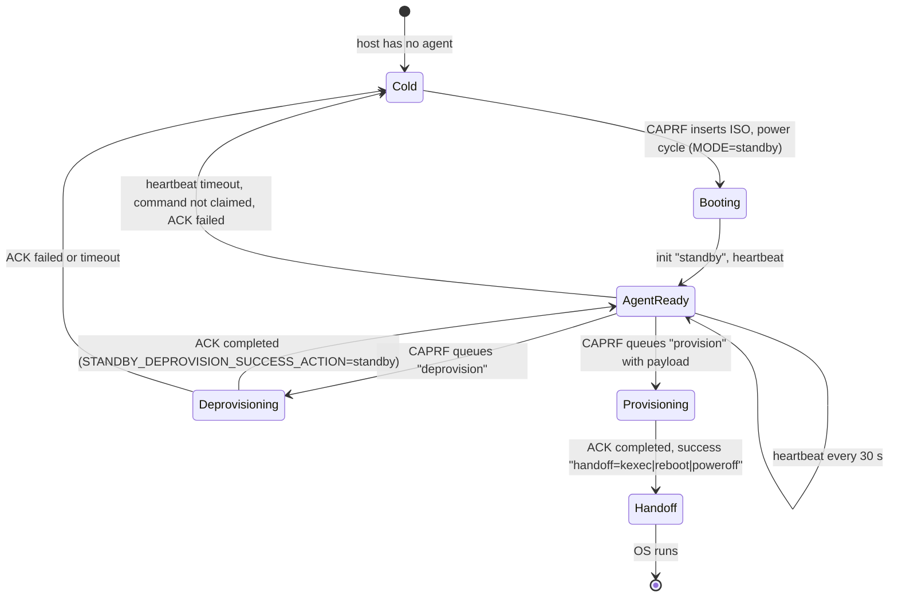

# Fast Deprovision and Provision Cycle for Reused Hosts

## Status

Design. Parts are implemented; the table in
[Implementation status](#implementation-status) lists them.

## Problem

The main complaint about the CAPRF legacy ramdisk is the time that a
deprovision and provision cycle of a reused host takes. Today every cycle
does three firmware boots:

1. CAPRF inserts the ISO and power cycles the host. The firmware runs POST,
   loads the ISO from the BMC virtual media, BOOTy brings up the network
   and BGP, wipes the disks and powers off.
2. CAPRF inserts the ISO again and power cycles the host. POST, ISO load,
   network and BGP again, then the image stream, the write, the boot
   configuration, and a power off.
3. CAPRF ejects the ISO and powers the host on. POST again, then the OS
   boots.

Only the wipe, the image stream and the boot configuration are work. The
rest is waiting for firmware, for the BMC and for the network.

## Goals

- Measure the cycle per phase on every PR (BOOTy) and every MR (CAPRF).
- A reused host does one firmware boot per cycle at most: BOOTy stays in
  RAM as an agent between deprovision and provision.
- BOOTy needs nothing from the ISO after the boot, so CAPRF ejects the
  virtual media as soon as BOOTy reports that it runs.
- Remove the fixed waits on the path.

## Non-goals

- New image formats or delivery methods. Image throughput is the subject
  of `proposal-image-delivery.md` (PR #700).
- Firmware or BIOS changes during the cycle. They need a real reboot.

## 1. Where the time goes today

### KVM (BOOTy, every PR)

`TestAgentCycleTimingQEMU` (KVM scenario `agent-cycle-timing`) boots a
CAPRF-style ISO (ISOLINUX, the deploy vars in the initramfs) on q35 with
SeaBIOS from a SCSI CD, like the kindmetal VMs. It stamps every serial line
with the host time and splits the run at the phase markers. The image is a
512 MiB raw disk, gzip, over the QEMU user network.

Lab baseline, `main` at af7dfed8, KVM on n2-standard-16, seconds:

| Phase | cold | agent | agent boot (once) |
|---|---:|---:|---:|
| boot: firmware, ISO, kernel | 9.4 | 0.0 | 4.8 |
| network bring-up | 2.1 | 0.0 | 1.0 |
| agent: wait for command | 0.0 | 16.5 | 0.0 |
| disk wipe | 2.3 | 2.3 | 0.0 |
| deprovision steps (other) | 2.3 | 2.3 | 0.0 |
| image stream | 3.2 | 3.9 | 0.0 |
| provision steps (other) | 3.4 | 3.2 | 0.0 |
| handoff (power off) | 2.1 | 2.0 | 0.0 |
| **total** | **25.0** | **30.3** | **5.9** |

- `cold` is two VMs: deprovision, then provision. `agent` is one VM in
  standby that runs a deprovision command and then a provision command.
- In KVM a boot costs 4.7 seconds. The agent path saved one boot but
  lost 16.5 seconds in the 10 second command poll (two polls per cycle).
- "deprovision steps (other)" and "provision steps (other)" each hold a
  2.0 second disk settle wait (`select-deprovision-disk`, `detect-disk`).
  The agent paid it twice in the same boot.
- "handoff" is a fixed 2 second sleep before the power off.

### kindmetal (CAPRF e2e, BOOTy EVPN jobs)

CAPRF pipeline 77623550, jobs `e2e-kindmetal-booty-evpn-bm4x` and
`e2e-kindmetal-booty-native-evpn-bm4x`, four provisions. Times are from the
controller step log (`Step timing summary`) and the VM serial console. The
image is a 12 GB raw image, lz4 compressed (8 GB transfer). The jobs also
inject fabric faults during the stream.

| Phase | seconds | Source |
|---|---:|---|
| CAPRF prepare: connect, ISO build, eject, insert, reset | 2 to 3 | controller steps |
| firmware and ISO load (sushy virtual media) | about 6 | `rebootSystem` to kernel banner |
| kernel to `/init` | 3.3 | console (`Run /init`) |
| BOOTy module load | 5 | console (before #758: one `loaded kernel module` line per module and retries on `Unknown symbol`; since #758: one `loaded kernel modules` line) |
| network: BGP established, then connectivity | 12 to 16 | console |
| disk settle (`detect-disk`) | 2.2 | console |
| disk wipe | 3.1 | console |
| image stream and write | 140 | console (`stream-image` to `partprobe`) |
| provision steps after the stream | 2.2 | console |
| run complete to power down (2 s sleep, log drain) | 3.3 | console |
| CAPRF shutdown wait, eject, power on | 5.6 | controller steps |
| OS firmware boot | about 6 | kindmetal |

The legacy ramdisk in the same pipeline family needed 247 to 465 seconds
in `handleEvents` for a provision and 13.5 seconds for a deprovision
(pipeline 77545911, job `e2e-kindmetal`).

### Real hardware

Not measurable in CI. The model uses two inputs that the CAPRF metrics
(section 6) will record per host:

- `P`: POST time, 2 to 5 minutes on current servers (vendor dependent,
  verify per fleet).
- `V`: virtual media load of the 59 MB ISO, 6 to 30 seconds at 2 to 10
  MB/s BMC throughput (verify per BMC).

Cold cycle on hardware: `3 P + 2 V + 2 (kernel, modules, network) + wipe +
stream + power transitions`. With `P = 3 min` the firmware alone is 9
minutes of every cycle.

## 2. The fast path for reused hosts

### Lifecycle

BOOTy side (implemented, `pkg/runmode/standby.go`):

- `MODE=standby` with `HEARTBEAT_URL` and `COMMANDS_URL`.
- `STANDBY_DEPROVISION_SUCCESS_ACTION=standby` keeps BOOTy in standby after
  a deprovision, in the same boot.
- A command payload carries the per-job vars (hostname, cloud-init, image
  URLs and checksums, kernel parameters). See the
  [agent mode contract](caprf-integration.md#agent-mode-contract).
- A `provision` command ends with the handoff: kexec, reboot or power off.

CAPRF side (to implement, on top of the agent endpoints of CAPRF !68 and the
token renewal of !288):

1. **Enter standby.** When a RedfishHost is released and has agent mode on
   (`RedfishMachine.spec.agentMode` of !68, or a host field), the
   deprovision job renders `MODE=standby` and
   `STANDBY_DEPROVISION_SUCCESS_ACTION=standby` instead of
   `MODE=deprovision`, power cycles once, and queues a `deprovision`
   command when the `init` status `standby` arrives.
2. **Eject early.** At the `init` callback CAPRF ejects the virtual media
   (`VirtualMedia.EjectMedia`). BOOTy runs from RAM (section 3).
3. **Release.** The deprovision ACK `completed` releases the host. CAPRF
   keeps the host in `AgentReady` while heartbeats arrive.
4. **Provision.** A new RedfishMachine that claims an `AgentReady` host
   gets a `provision` command instead of the ISO steps (`buildImage`,
   `insertVirtualMedia`, `rebootSystem`). The payload is a deploy archive
   (PR #730): the tar.gz of the deploy tree that the ISO builder renders
   for the new machine, with its vars, cloud-init seed and machine files.
   A vars-only payload is not enough, the per-machine data are files.
   `handleEvents` waits for `init` and `success` as today.
5. **Handoff.** The success message names the handoff (section 4.7). For
   `kexec` and `reboot` CAPRF does not power cycle; for `poweroff` it keeps
   today's `shutdownSystem`, `turnOnSystem`.

### Job hand-off API

| Endpoint | Change |
|---|---|
| `GET /agent/commands` | Long poll: with `?wait=<s>` (BOOTy sends 20) the server holds the request until a command is queued or the wait ends, capped at 25 s. Without the parameter it answers at once (compatible). |
| `POST /agent/commands/ack` | The ACK ends the command. CAPRF records it on the machine (event and condition). |
| `POST /agent/heartbeat` | Unchanged. |
| token endpoint (!288) | The agent keeps the token of the job that booted it (machine identity of the deprovision). CAPRF keeps an agent registry per host (`host -> agent identity, last heartbeat`); the provision job of the next machine queues its command and subscribes to events under the agent identity. An idle agent renews its token through `TOKEN_URL`. The token is revoked when the provision ends (BOOTy leaves the ramdisk) or the host takes the cold path. A payload can not change `TOKEN` (contract). |

### Timeouts and fallback

| Timer | Value | On expiry |
|---|---|---|
| Heartbeat | 30 s interval, unhealthy after 120 s | Host leaves `AgentReady`, next job takes the cold path. 120 s covers one missed heartbeat plus a 20 s long poll. |
| Command claim | 60 s after queueing | CAPRF removes the command and takes the cold path (power cycle with the ISO). |
| Command run | the job timeout of today | Same as a cold job; BOOTy sends no heartbeat while a command runs. |
| ACK `failed` | at once | Cold path for the next attempt. The failure message goes to the machine events. |

The cold path is always available: it inserts the ISO and power cycles, so a
crashed or hung agent is replaced by a fresh boot. The power cycle also
recovers a host whose agent token was revoked.

## 3. Running from RAM

Findings (BOOTy `main` and release v0.2.0-rc.15):

- The kernel unpacks the initramfs into the rootfs. The CAPRF ISO builder
  puts `/deploy` into a second cpio (`deploy.cpio`) that ISOLINUX loads as a
  second initrd. BOOTy reads `/deploy/vars` from the rootfs.
- No BOOTy code mounts the CD. The initramfs has no `isofs`, `sr_mod` or
  squashfs, so it could not read the CD even if it tried.
- Kernel modules are in the initramfs (74 `.ko` files in the default
  flavour) and are loaded by BOOTy at start. Later loads come from the
  rootfs too.
- NIC firmware: the initramfs has no `/lib/firmware`. NICs with firmware on
  the card (Mellanox, Broadcom) do not need it; `ice` (E810) runs without
  its DDP package (safe mode). This is not an ISO dependency: the ISO has no
  firmware either. A separate change can add `ice.pkg` to the initramfs.
- kexec loads the target kernel and initrd from the target disk.
- The rescue shell (busybox) is in the initramfs.

So the virtual media can be ejected right after BOOTy reports `init`. The
KVM cycle test ejects the CD through the QEMU monitor after the first
heartbeat and runs the whole deprovision and provision cycle without it.

RAM footprint:

| Item | Size |
|---|---:|
| default flavour initramfs, unpacked rootfs | 167 MiB |
| gobgp flavour initramfs, unpacked rootfs | 140 MiB |
| KVM test ramdisk at standby start (kernel, rootfs, BOOTy) | 186 MiB used of 956 MiB |

Standby logs `memTotalMiB` and `memAvailableMiB` when it starts. The guard
is the existing `HEALTH_MIN_MEMORY_GB` check (health-checks step). CAPRF
should set it to 4 for agent mode: the ramdisk needs less than 0.5 GiB, and
qcow2 images need a tmpfs as large as the image (see
`proposal-image-delivery.md`), so qcow2 hosts need more.

## 4. Other cycle-time work

Savings per cycle; "KVM" and "kindmetal" are measured in the cases above,
"HW" uses the model of section 1.

| # | Change | Saves | Status |
|---|---|---|---|
| 4.1 | Agent reuse: no POST, ISO load, kernel, module load and network for the provision | KVM 5.7 s, kindmetal 26 to 30 s, HW `P + V + 25 s` | BOOTy done; CAPRF wiring planned |
| 4.2 | Skip the deprovision power off and the second power cycle | kindmetal 6 s (`forceOffSystem`) plus 4.1; HW `P + V` | with 4.1 |
| 4.3 | Long poll and re-poll after a command | KVM 15.5 s (16.5 to 1.0); on average 5 s per command with a 10 s poll | BOOTy done; CAPRF server planned |
| 4.4 | Disk settle once per boot while the disk set does not change | 2 s per later command | BOOTy done |
| 4.5 | No 2 s sleep before the handoff | 2 s per provision | BOOTy done |
| 4.6 | Eject the media at `init`, not after the job | kindmetal 0.8 to 1.2 s off the end of the job; HW BMC eject 1 to 10 s | CAPRF planned |
| 4.7 | kexec into the target instead of power off, eject, power on | kindmetal about 11 s (shutdown 3.4, power on 1.4, firmware 6); HW `P + 5 s` | handoff contract planned; see below |
| 4.8 | Wipe: skip the provision wipe after a deprovision in the same boot; wipe disks in parallel | KVM 1.1 s, kindmetal 3 s; parallel: `(n - 1)/n` of the wipe on `n` disks | proposed |
| 4.9 | Network: BGP connect retry and idle hold timers, BFD is already on | kindmetal 7 to 11 s to `BGP established`, once per boot | coordinate with the networking owners |
| 4.10 | Image stream throughput | kindmetal 140 s of the 180 s provision | `proposal-image-delivery.md` (PR #700) |
| 4.11 | Preload the next image while idle | up to the whole stream (140 s kindmetal) when CAPRF knows the image | proposed, below |
| 4.12 | Module load in dependency order (no `Unknown symbol` retries) | about 5 s per boot; measured 2.5 s to 0.9 s on a 4-CPU VM, plus 43 KB less console output | done (#758) |
| 4.13 | CAPRF power state polling every 1 s instead of 3 s | about 1 s per power transition, 4 to 6 per cold cycle | CAPRF planned |

### kexec (4.7)

kexec saves one POST per provision and is the largest single saving on
hardware after the agent reuse. It skips everything the firmware does on a
reset; [kexec.md](kexec.md) (PR #705) lists every limitation. Its decision
table applies:

- reboot is required for attestation and TPM-sealed keys, after firmware,
  BIOS or SR-IOV firmware changes, in Secure Boot strict mode, and for A/B
  trial boots that rely on boot counting or `BootNext`;
- kexec only where it is safe.

It stays a configurable choice: `DISABLE_KEXEC`, `SUCCESS_ACTION` and
`SECUREBOOT_REENABLE` select it per host or per command payload. A CAPRF
flow that power cycles after the success callback must know that BOOTy
kexecs, or it shuts down the new OS during its first boot. The success
message therefore names the handoff (`handoff=kexec`, `reboot` or
`poweroff`) and CAPRF skips the power cycle for `kexec` and `reboot`.

### Preload (4.11)

An idle agent has a wiped disk and nothing to do. If CAPRF knows the next
image (for example from the MachineTemplate of the pool), a `prefetch`
command with the image URL and checksum lets BOOTy stream the image to the
disk while idle. A later `provision` with the same URL and checksum
verifies the written image and skips the stream. A different image streams
as today. The image is written to the disk, not to RAM: a 12 GB image does
not fit into the ramdisk.

## 5. CI timing on every PR

BOOTy: the KVM matrix scenario `agent-cycle-timing` writes
`cycle-timing.json` (artifact `cycle-timing-report`) and a table to the job
summary. On pull requests it downloads the report of the newest `main` run
and shows the delta per phase. A cycle total that grows by more than
`BOOTY_CYCLE_REGRESSION_PCT` (25) percent and by more than
`BOOTY_CYCLE_REGRESSION_MIN_SECONDS` (10) is a regression.
`BOOTY_CYCLE_REGRESSION_MODE=warn` (default) writes a warning annotation;
`fail` fails the job. The three are repository variables.

A PR comment with the table would need the workflow token with
`pull-requests: write`. It is not enabled; the job summary carries the
table.

CAPRF: an e2e job runs a deprovision and provision cycle through the real
controller, cold and through the agent, parses the controller step log and
writes a GitLab metrics report and a dotenv file.

## 6. Before and after

KVM lab, the same host and test, seconds:

| Cycle | main | after the standby changes |
|---|---:|---:|
| cold (two ISO boots) | 25.0 | 22.6 |
| agent (one boot, two commands) | 30.3 | 10.2 |

GitHub runners (KVM matrix job `agent-cycle-timing`, PR #715 before and
PR #716 after): cold 18.9 to 15.7 s, agent 27.7 to 9.2 s.

kindmetal, CAPRF BOOTy L2 e2e through the real controller (cycle report of
CAPRF !297, 7 hosts, mean seconds; 6 hosts in the second run because one
mirrored host failed its disk selection with the newer BOOTy build):

| Phase | pinned BOOTy 0.2.0-rc.12 (!297) | BOOTy #724 build (!299) |
|---|---:|---:|
| deprovision: power off | 15.4 | 3.0 |
| provision: power off and on | 91.0 | 10.4 |
| provision: ramdisk boot, network, task | 335.9 | 331.0 |
| cycle (mean deprovision + mean provision) | 470.6 | 375.8 |

rc.12 kexecs or reboots after the success callback without telling CAPRF.
CAPRF then sent a graceful shutdown to the new OS and waited for its 90 s
timeout before it forced the host off: the handoff race of section 4.7,
measured. The #724 build names the handoff (`poweroff` here, because CAPRF
asks for legacy compat); with `kexec` the provision power cycle drops out.

The EFI runtime services survive BOOTy's kexec on x86: in the KVM `kexec`
scenario under OVMF the target lists the EFI variables (PR #725). So kexec
needs no reboot fallback for targets that use `efibootmgr`.

## Implementation status

| Item | Where | State |
|---|---|---|
| Cycle timing test and CI report | BOOTy KVM matrix | PR |
| Long poll, re-poll, disk settle once, no handoff sleep, RAM log | BOOTy standby | PR |
| GRUB default entry for kexec (`DefaultEntry`, real fixtures) | BOOTy | PR #720 |
| Handoff in the success message | BOOTy | PR #724 |
| BGP Cease and BFD AdminDown before kexec, reboot and power off | BOOTy | PR #723 |
| KVM `kexec` scenario kexecs; EFI runtime after kexec verified | BOOTy | PR #725 |
| Deploy archive payload (per-job files for the agent) | BOOTy | PR #730 |
| Eject at `init`, skip power cycle for kexec and reboot | CAPRF | !296 |
| CAPRF cycle timing job (cold path) | CAPRF e2e | !297 |
| Long poll server | CAPRF | !298 (on !68) |
| Agent reuse in the controller (registry, deprovision to standby, provision by command, fallback) | CAPRF | planned; needs !68, !288 and !285 on one branch |
| Wipe skip and parallel wipe, preload, module order | BOOTy | proposed |
